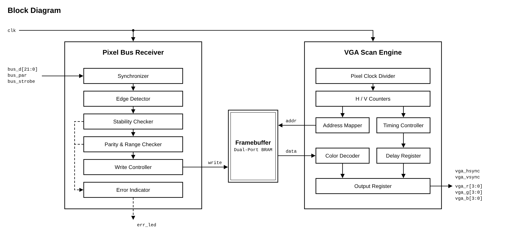
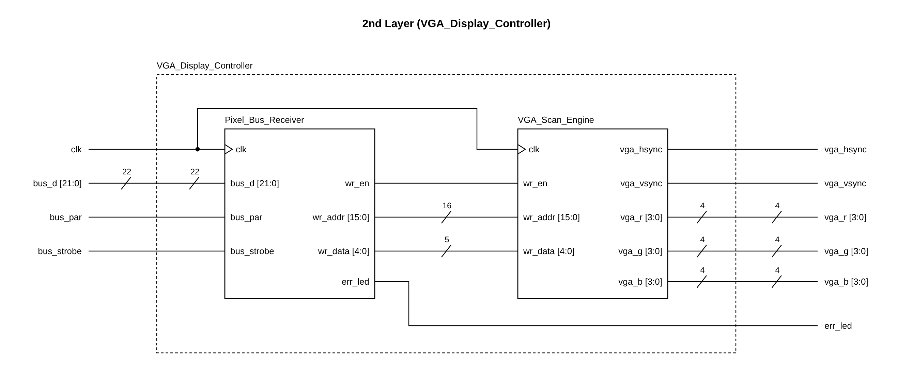
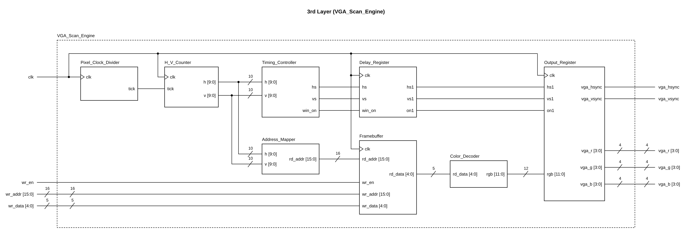
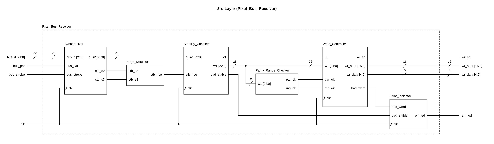

# VGA Display Chip on the EDGE Spartan-7

An FPGA that acts as a tiny **VGA display chip**. A microcontroller sends pixels over a 24-wire
parallel bus; the FPGA stores them in Block RAM and continuously scans them out as a standard **640x480 @ 60 Hz VGA** signal.



Editable draw.io sources for every diagram are in [`diagrams/`](diagrams/).

## 1. Board

| Item | Value |
|---|---|
| Board | **EDGE Spartan-7** development board |
| FPGA | **Xilinx/AMD Spartan-7 XC7S15-FTGB196-1** |
| Clock | **50 MHz** on pin **H11** |
| Block RAM | **360 Kb** = 10 x RAMB36 (36 Kb each) |
| Tool / language | Vivado, Verilog |
| VGA | 12-bit (RGB 4-4-4) through a resistor DAC on the board, plus HSYNC and VSYNC |
| I/O voltage | 3.3 V (LVCMOS33) |

### Why 320x180 and 5 bits per pixel

All the Block RAM the chip has is **360 Kb**, and the framebuffer has to fit in it.

| Picture | Bits per pixel | Memory needed |
|---|---|---|
| 640x480 | 12 | 3,686,400 bits = 3,600 Kb |
| 320x240 | 12 | 921,600 bits = 900 Kb |
| 320x180 | 12 | 691,200 bits = 675 Kb |
| 320x180 | 6 | 345,600 bits = 337.5 Kb |
| **320x180** | **5** | **288,000 bits = 281.25 Kb** |
| 320x180 | 4 | 230,400 bits = 225 Kb |

The aspect ratio is 16:9 (320x180), drawn 2x2 into a **640x360** area in the middle of the
640x480 VESA frame: 60 black lines above and 60 below. The VGA signal itself stays the
standard VESA 640x480 @ 60 Hz mode (see [References](#7-references)).

## 2. Pinout

### 2.1 Bus pins (plug in order)

| EDGE board pin | FPGA pin | Signal | Used for |
|---|---|---|---|
| J5 pin5 | L14 | `bus_d[0]` | X bit 0 |
| J5 pin6 | M13 | `bus_d[1]` | X bit 1 |
| J5 pin7 | H14 | `bus_d[2]` | X bit 2 |
| J5 pin8 | H13 | `bus_d[3]` | X bit 3 |
| J5 pin9 | F11 | `bus_d[4]` | X bit 4 |
| J5 pin10 | G11 | `bus_d[5]` | X bit 5 |
| J5 pin11 | C14 | `bus_d[6]` | X bit 6 |
| J5 pin12 | D14 | `bus_d[7]` | X bit 7 |
| J5 pin13 | E13 | `bus_d[8]` | X bit 8 |
| J5 pin14 | F13 | `bus_d[9]` | Y bit 0 |
| J5 pin15 | F14 | `bus_d[10]` | Y bit 1 |
| J5 pin16 | G14 | `bus_d[11]` | Y bit 2 |
| J5 pin17 | D13 | `bus_d[12]` | Y bit 3 |
| J5 pin18 | D12 | `bus_d[13]` | Y bit 4 |
| J5 pin19 | E12 | `bus_d[14]` | Y bit 5 |
| J5 pin20 | F12 | `bus_d[15]` | Y bit 6 |
| LCD D0 | M4 | `bus_d[16]` | Y bit 7 |
| LCD D1 | L5 | `bus_d[17]` | color B0 |
| LCD D2 | P11 | `bus_d[18]` | color B1 |
| LCD D3 | N11 | `bus_d[19]` | color G |
| LCD D4 | P13 | `bus_d[20]` | color R0 |
| LCD D5 | M14 | `bus_d[21]` | color R1 |
| LCD D6 | M12 | `bus_par` | even parity bit |
| LCD D7 | K12 | `bus_strobe` | write strobe (rising edge) |
| J5 pin4 | - | GND | **common ground with the sender, required** |

Notes
- J5 pin1 (5 V), pin2 (NC) and pin3 (3V3) are power pins: connect no bus signals to them. Do not feed 3V3 from the sender into the board.
- LCD E (P5) and LCD RS (M5) are not used.
- The LCD data pins D0..D7 are shared with board LEDs 7..0, so those LEDs flicker while pixels are being written.
- The bus is 3.3 V (LVCMOS33): a 3.3 V sender connects directly, no level shifter.

### 2.2 Board LEDs used as status

| FPGA pin | Board LED | Signal | Meaning |
|---|---|---|---|
| M1 | LED 15 | `err_led` | lit 100 ms after a rejected word (bad parity, out of range, or unstable data) |

### 2.3 Clock and VGA connector

| FPGA pin | Signal | Used for |
|---|---|---|
| H11 | `clk` | 50 MHz system clock |
| C4 | `vga_hsync` | horizontal sync, active low |
| E4 | `vga_vsync` | vertical sync, active low |
| B6, D3, C3, A4 | `vga_r[0..3]` | red, 4 bits (bit 3 = MSB) |
| A3, B3, A2, B5 | `vga_g[0..3]` | green, 4 bits |
| A5, B2, B1, C5 | `vga_b[0..3]` | blue, 4 bits |

All pins are LVCMOS33. Bus inputs have an internal pull-down so a disconnected wire reads 0.
The configuration voltage is set with `CFGBVS VCCO` and `CONFIG_VOLTAGE 3.3`.

## 3. How it works

The design has two blocks that share one framebuffer. The **Pixel Bus Receiver** checks each
pixel word from the sender and writes it into the framebuffer. The **VGA Scan Engine** reads the
framebuffer continuously and drives the VGA pins.



Sections 3.1 to 3.4 cover the VGA Scan Engine. Sections 3.5 and 3.6 cover the bus and the
Pixel Bus Receiver.

### 3.1 VGA signal generation



Everything is driven by a counter pair that runs at the pixel clock. The **Pixel Clock Divider**
makes the 25 MHz tick, and the **H / V Counters** count pixels and lines.

```
50 MHz clk --> tick (/2 = 25 MHz enable) --> h counter 0..799 --> v counter 0..524
```

The timing is the **VESA DMT 640 x 480 @ 60 Hz mode (DMT ID 04h)**, from *VESA Display
Monitor Timing (DMT) Standard*, Version 1.0 Rev. 13, section 4 (page 21). DMT lists the 8-pixel /
8-line black borders as separate rows. The counters here fold each border into the
neighbouring porch, so the totals are the same:

| | Visible | Front porch (DMT: border + porch) | Sync pulse | Back porch (DMT: porch + border) | Total |
|---|---|---|---|---|---|
| Horizontal (pixels) | 640 | 16 = 8 + 8 | 96 | 48 = 40 + 8 | 800 |
| Vertical (lines) | 480 | 10 = 8 + 2 | 2 | 33 = 25 + 8 | 525 |

- The **Timing Controller** drives HSYNC low while `656 <= h < 752` and VSYNC low while `490 <= v < 492`. Both are negative polarity, as DMT requires for this mode.
- Outside the visible area the RGB outputs are forced to 0 (borders and blanking are black).
- DMT gives a pixel clock of 25.175 MHz (59.940 Hz) with a tolerance of +/-0.5%. This design uses 25.000 MHz (50 MHz / 2), which gives **59.52 Hz** and is about 0.7% slow, slightly outside that tolerance. It displayed correctly on the monitor used for testing, but a stricter monitor could reject it. An MMCM to make 25.175 MHz is the planned fix.

### 3.2 Picture window and addresses

The **Address Mapper** turns the screen position (h, v) into a framebuffer address.

```
screen line  0..59      black bar
screen line 60..419     picture (360 lines = 180 framebuffer rows x 2)
screen line 420..479    black bar
```

- `x_fb = h / 2` (0..319), `y_fb = (v - 60) / 2` (0..179)
- `address = y*320 + x = (y << 8) + (y << 6) + x` (shifts and adds, no multiplier)
- Because the screen pixel counter is divided by 2, each framebuffer pixel appears as a 2x2 block.

### 3.3 Framebuffer and pipeline

The write port (from the Pixel Bus Receiver) and read port (inside the VGA Scan Engine) are separate, so the
sender can draw while the monitor is being refreshed. The read path has a fixed delay and
the **Delay Register** holds the sync signals for the same amount:

```
t+0 : h, v counters  -> framebuffer read address
t+1 : RAM data arrives  | hsync, vsync, "window on" flag delayed one clock
t+2 : color expanded to RGB444 -> registered VGA outputs
```

The framebuffer is initialized to black at configuration. There is **no clear command**:
to erase, write color 0 over the pixels.

### 3.4 Color format and expansion to 4 bits

This is the **Color Decoder** block.

The framebuffer stores **5 bits per pixel**, but the VGA output takes **4 bits per color**
(12 bits in total). The stored bits are split into three fields:

```
color[4:3] = R (2 bits)    color[2] = G (1 bit)    color[1:0] = B (2 bits)
```

Before the pixel goes to the VGA pins, each field is expanded to 4 bits by
**bit replication**: the field's bits are repeated until they fill 4 bits.

```
R (4 bit) = { R, R }          the 2 bits written twice
G (4 bit) = { G, G, G, G }    the 1 bit written four times
B (4 bit) = { B, B }          the 2 bits written twice
```

In `vga_gfx.v` this is one line: `colour_to_rgb = {r, r, {4{g}}, b, b}`.

| Stored field | Expanded to 4 bits | Hex | Brightness |
|---|---|---|---|
| R or B = `00` | `0000` | 0 | 0% |
| R or B = `01` | `0101` | 5 | 33% |
| R or B = `10` | `1010` | A | 67% |
| R or B = `11` | `1111` | F | 100% |
| G = `0` | `0000` | 0 | 0% |
| G = `1` | `1111` | F | 100% |

This gives 4 x 2 x 4 = **32 colors**. Handy values: `00000` black, `11000` red, `00100` green,
`00011` blue, `11100` yellow, `00111` cyan, `11011` magenta, `11111` white.

### 3.5 Bus protocol (what the sender does)

One pixel = one word on the wires + one strobe pulse.

| Signal | Width | Meaning |
|---|---|---|
| `bus_d[8:0]` | 9 | X, 0..319 |
| `bus_d[16:9]` | 8 | Y, 0..179 |
| `bus_d[21:17]` | 5 | color `{R[1:0], G, B[1:0]}` |
| `bus_par` | 1 | even parity: `bus_par == ^bus_d` |
| `bus_strobe` | 1 | rising edge = "read the bus now" |

**Parity (even).** `bus_par` is the XOR of the 22 data bits, so the total number of 1s across
all 23 wires (`bus_d` + `bus_par`) is always even. Put another way, `bus_par = 1` when `bus_d`
holds an odd number of 1s.

| Data bits | Number of 1s | `bus_par` | Total 1s |
|---|---|---|---|
| `0000` | 0 | 0 | 0 |
| `0111` | 3 | 1 | 4 |
| `0110` | 2 | 0 | 2 |

The receiver XORs all 23 bits and accepts the word only when the result is 0
(`par_ok = ~(^w1)` in `bus_rx.v`). In Python on the sender:

```python
parity = bin(data).count("1") & 1     # data = bus_d[21:0]
word   = data | (parity << 22)
```

Sender timing (receiver clock 50 MHz):

```
data + parity ---<====== stable ===========================>---
strobe        ______________/``````````````\__________________
                 >= 50 ns   >= 100 ns hold   >= 50 ns low
```

1. put data and parity on the wires
2. wait about 50 ns
3. strobe high, hold at least 100 ns without changing data
4. strobe low, wait about 50 ns, next word

A slow sender (for example a microcontroller toggling pins in software, microseconds per write) easily meets these minimums.

### 3.6 Receiver checks



```
bus pins -> Synchronizer            2 flip-flops on every line
         -> Edge Detector           rising edge of the strobe
         -> Stability Checker       word captured on the edge must match the next clock's sample
         -> Parity & Range Checker  parity even? X <= 319? Y <= 179?
         -> Write Controller        compute address, one-clock write pulse into the framebuffer
```

Any failed check drops the word, and the **Error Indicator** lights **err_led (LED 15)** for 100 ms
(5,000,000 clocks at 50 MHz, set by `ERR_MS` in `bus_rx.v`).

## 4. Files

| File in repo / Vivado project | Module | Purpose |
|---|---|---|
| `vga_bus_rx.v` (project: `bus_rx.v`) | `vga_bus_rx` | **Pixel Bus Receiver**: checks bus words, writes the framebuffer |
| `vga_gfx.v` | `vga_gfx` | **VGA Scan Engine**: framebuffer, VGA timing, color decode |
| `vga_bus_top.v` (project: `vga_top.v`) | `vga_bus_top` | **real top**: bus input to VGA |
| `vga_pattern_top.v` | `vga_pattern_top` | test top: 32-color chart, no sender |
| `vga_bus.xdc` (project: `vga.xdc`) | - | constraints for `vga_bus_top` |
| `vga_pattern.xdc` | - | constraints for `vga_pattern_top` (clock + VGA only) |

Use **one** top and **one** matching XDC at a time. Do not enable `vga_pattern.xdc` and
`vga.xdc` together, and do not use the stock `spartan7.xdc`, which assigns the same pins
to several peripherals.

### Diagrams

| File | Content |
|---|---|
| `diagrams/block_diagram.drawio` / `.png` | Block diagram of the whole design |
| `diagrams/top_down_layers.drawio` | Top-down design, one page per layer (Top Layer, 2nd Layer, 3rd Layer) |
| `diagrams/top_layer.png` | Top Layer: the chip as one block with its pins |
| `diagrams/second_layer.png` | 2nd Layer: Pixel_Bus_Receiver and VGA_Scan_Engine |
| `diagrams/third_layer_pixel_bus_receiver.png` | 3rd Layer: inside Pixel_Bus_Receiver |
| `diagrams/third_layer_vga_scan_engine.png` | 3rd Layer: inside VGA_Scan_Engine |

## 5. How to run

**A. Check the VGA side first (no sender needed)**
1. Set `vga_pattern_top` as the top module and enable only `vga_pattern.xdc`.
2. Generate the bitstream and program the board.
3. The monitor should show 8 x 4 color swatches, each with a white border.

**B. Run with a sender**
1. Set `vga_bus_top` as the top module and enable only `vga.xdc`. Re-run synthesis, implementation and bitstream, then reprogram.
2. Wire the sender to the pins in section 2.1, including the common ground.
3. Write pixels using the protocol in section 3.5. Start with a white frame (X = 0 or 319, Y = 0 or 179, color 31) to check the X/Y wires, then the color chart to check the color wires.

## 6. Troubleshooting

| Symptom | Likely cause |
|---|---|
| Monitor says no signal | wrong top or XDC loaded, or VGA cable / pins |
| Picture black, LED 15 lit | words arrive but are rejected: a bus wire is loose or in the wrong hole, or ground is missing |
| Picture black, LED 15 off | the FPGA never sees a strobe: check the strobe wire (LCD D7), or an old bitstream is loaded |
| Colors wrong, position right | color wires (LCD D1..D5) swapped |
| Pixels in the wrong place | X/Y wires swapped |
| Vivado: unconstrained port or duplicate pin | two XDC files enabled, or a port name changed |

## 7. References

- VESA, *Display Monitor Timing (DMT) Standard*, Version 1.0, Rev. 13 (8 Feb 2013): [VESA-DMT-1.13.pdf](https://glenwing.github.io/docs/VESA-DMT-1.13.pdf). The video timing used here is the 640 x 480 @ 60 Hz mode, DMT ID 04h (section 4, page 21 of the PDF): 25.175 MHz pixel clock, 800 x 525 total, negative sync polarity.
